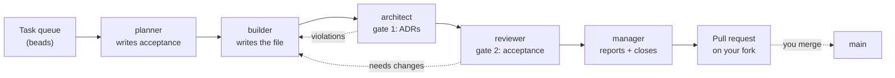

# Actual Factory Demo

Build a working software factory on Claude Code in ~15 minutes with Gas City, then watch five agents carry a task from a queue to an open pull request fully autonomously.

## Table of contents

- [Software Factory Overview](#software-factory-overview)
- [Walkthrough](#walkthrough)
  - [1. Prerequisites](#1-prerequisites)
  - [2. Fork this repo](#2-fork-this-repo)
  - [3. Create the factory](#3-create-the-factory)
  - [4. Install the pack](#4-install-the-pack)
  - [5. Seed the task queue](#5-seed-the-task-queue)
  - [6. Run a task](#6-run-a-task)
- [Join our Software Factory Intensive for more!](#join-our-software-factory-intensive-for-more)

## Software Factory Overview

This tutorial uses the [Gas City](https://github.com/gastownhall/gascity) framework to build a complete software factory layer on top of Claude Code. This repo acts as the workspace, or **rig**, that the factory works on. You hand the factory a task, and five agents pass it between themselves until the result lands as a pull request you may review.



The work itself is simply to produce ASCII art for a letter, with a rhyming couplet underneath each. The focus, though, is on understanding how work gets dispatched, who reviews it, and where the quality gates sit.

## Walkthrough

### 1. Prerequisites

| Tool | Version | Why |
| --- | --- | --- |
| [Claude Code](https://claude.com/claude-code) | latest | The coding agent the factory drives |
| [`gc`](https://github.com/gastownhall/gascity) | 1.4.0 | Gas City itself |
| [`bd`](https://github.com/gastownhall/beads) | 1.1.2 | The task queue the agents pull work from |
| [`dolt`](https://github.com/dolthub/dolt) | 2.2.3 | Storage behind `bd` |
| [`gh`](https://cli.github.com/) | no minimum | Agents open pull requests through it |
| [`tmux`](https://github.com/tmux/tmux) | no minimum | Session backend every agent runs in |
| [`git`](https://git-scm.com/) | no minimum | Rig checkouts and agent commits |
| [`jq`](https://jqlang.github.io/jq/) | no minimum | JSON parsing in the pack's scripts |
| [`flock`](https://github.com/discoteq/flock) | no minimum | Lock coordination for `bd` |
| `pgrep`, `lsof` | no minimum | Process and port checks |

`gc`, `bd`, and `dolt` are pinned to exact versions below, because Gas City enforces a
[minimum version](https://github.com/gastownhall/gascity#prerequisites) for each. The rest have no
minimum, so the commands install whatever your platform currently ships.

**Claude Code is the only paid prerequisite. All other components are fully open-source.**

#### If you are on macOS

```bash
brew install tmux git jq flock gh
brew install gastownhall/gascity/gascity   # gc — the tap pins 1.4.0
```

`pgrep` and `lsof` are already part of macOS.

`bd` isn't in Homebrew, and Homebrew has no versioned formula for `dolt`, so both come from their
release tarballs:

```bash
ARCH=$(uname -m | sed 's/x86_64/amd64/; s/aarch64/arm64/')

# dolt 2.2.3
tmp=$(mktemp -d)
curl -fsSL "https://github.com/dolthub/dolt/releases/download/v2.2.3/dolt-darwin-${ARCH}.tar.gz" | tar -xz -C "$tmp"
sudo install "$tmp/dolt-darwin-${ARCH}/bin/dolt" /usr/local/bin/dolt && rm -rf "$tmp"

# bd 1.1.2
tmp=$(mktemp -d)
curl -fsSL "https://github.com/gastownhall/beads/releases/download/v1.1.2/beads_1.1.2_darwin_${ARCH}.tar.gz" | tar -xz -C "$tmp"
sudo install "$tmp/bd" /usr/local/bin/bd && rm -rf "$tmp"
```

#### If you are on Linux (Debian/Ubuntu)

```bash
sudo apt update
sudo apt install -y tmux git jq curl util-linux procps lsof
```

`flock` comes from `util-linux` and `pgrep` from `procps`. Install `gh` from
[cli.github.com](https://cli.github.com/), then the three pinned tools:

```bash
ARCH=$(uname -m | sed 's/x86_64/amd64/; s/aarch64/arm64/')

# gc 1.4.0
tmp=$(mktemp -d)
curl -fsSL "https://github.com/gastownhall/gascity/releases/download/v1.4.0/gascity_1.4.0_linux_${ARCH}.tar.gz" | tar -xz -C "$tmp"
sudo install "$tmp/gc" /usr/local/bin/gc && rm -rf "$tmp"

# dolt 2.2.3
tmp=$(mktemp -d)
curl -fsSL "https://github.com/dolthub/dolt/releases/download/v2.2.3/dolt-linux-${ARCH}.tar.gz" | tar -xz -C "$tmp"
sudo install "$tmp/dolt-linux-${ARCH}/bin/dolt" /usr/local/bin/dolt && rm -rf "$tmp"

# bd 1.1.2
tmp=$(mktemp -d)
curl -fsSL "https://github.com/gastownhall/beads/releases/download/v1.1.2/beads_1.1.2_linux_${ARCH}.tar.gz" | tar -xz -C "$tmp"
sudo install "$tmp/bd" /usr/local/bin/bd && rm -rf "$tmp"
```

#### Check

Version mismatches surface as confusing errors several steps later, so confirm all of it now:

```bash
gc version      # 1.4.0
bd version      # 1.1.2
dolt version    # 2.2.3
gh auth status  # must report a logged-in account
tmux -V && git --version && jq --version && flock --version
```

If `gh` isn't logged in yet, run `gh auth login`.

### 2. Fork this repo

**This repo is also the rig.** Your factory writes its output back into a checkout of this same repository. You do need somewhere you can push, though:

```bash
mkdir -p ~/factory-demo && cd ~/factory-demo
gh repo fork actual-software/actual-factory-demo --clone --remote
```

The city and the rig live side by side. By the end of step 3 the directory looks like this:

```text
~/factory-demo/
├── factory1/              # the Gas City, created next
└── actual-factory-demo/   # your fork, which is also the rig
```

### 3. Create the factory

```bash
cd ~/factory-demo
gc init factory1
```

`gc init` is interactive and asks two questions:

- Config template: **minimal** (option `2`)
- Provider: **Claude Code**

That writes `factory1/`, holding a `city.toml` and a `pack.toml`.

Now start it:

```bash
gc start
```

`gc start` registers the city with the supervisor, installs the background service if this is your first city, and brings up the city's Dolt server along with its agents.

**Check:**

```bash
gc cities       # factory1, with its absolute path
gc status       # Controller: supervisor-managed (PID ...)
gc doctor       # ✓ pass, ⚠ warning, ✗ error
```

`gc doctor --fix` clears the routine warnings a fresh city reports. Run `gc doctor` again afterwards and you should be down to passes.

### 4. Install the pack

A **pack** is how Gas City ships agents, formulas, and config as one installable unit. The one for this demo lives in `factory/`.

Register your fork as the rig, then import the pack into it:

```bash
cd "$FACTORY_PATH"
export RIG_PATH="$(cd ../actual-factory-demo && pwd)"

gc rig add "$RIG_PATH" --name ascii-art
gc import add --rig ascii-art "$RIG_PATH/factory"
gc restart
```

The rig is named `ascii-art` because that's the work it holds.

The `--rig ascii-art` binds the five agents to the rig, which is what puts them in your fork's checkout when they run. Import without it and the agents come up at city scope, where there's no repo to write to.

**Check:**

```bash
gc import list --rig ascii-art   # factory, with a locked commit
gc formula list --rig ascii-art  # ascii-art, alongside the built-ins
gc status                        # five ascii-art/factory.* agents
```

### 5. Seed the task queue

The agents read work from **beads**, which is a task queue backed by Dolt. Yours is empty right now. The seed script opens two epics and twenty-six tasks, one per letter:

```bash
cd "$RIG_PATH"
./seed.sh
```

**Check:**

```bash
bd list --type=epic   # Letters a–m and Letters n–z
bd ready              # twenty-six tasks with no blockers
```

### 6. Run a task

Pick a letter, and grab its bead id:

```bash
cd "$RIG_PATH"
export BEAD_ID=$(bd list --type=task --status=open --limit 0 | grep -E "Implement a\.md$" | awk '{print $2}')
bd show "$BEAD_ID"
```

Hand it to the factory:

```bash
cd "$FACTORY_PATH"
gc sling ascii-art/factory.planner "$BEAD_ID" --on ascii-art
```

The breakdown of the command is as follows:

- `ascii-art/factory.planner` names the target as `<rig>/<pack>.<agent>`
- `$BEAD_ID` is the task
- `--on ascii-art` attaches the formula, which is what tells every agent downstream what runs after it

To watch the agents work, simply find a session you'd like to watch and attach to it like so:

```bash
gc session list
gc session attach <session-name>
```

**Note: detach with `Ctrl+b` then `d`.** Never `Ctrl+c`. That one kills the session outright, and you may need to restart the agent or city to resume work.

Once the factory is finished, you will see a PR on the other side that you can inspect and merge:

```bash
cd "$RIG_PATH"
gh pr view "$(bd show "$BEAD_ID" --json | jq -r '.[0].metadata.pr_url')" --web
gh pr merge <number> --merge
```

You should see one new file at `ascii/a.md`, holding an H1 with the letter, a fenced code block with the art in it, and a two-line rhyme. Those constraints aren't arbitrary. They come from [ADR 0001](./adrs/0001.ADR.ASCII.md), which the agents read as part of their context. You can also run another if you like. Same loop, `b.md` instead of `a.md`.

## Join our Software Factory Intensive for more!

This is a small sample of what is covered in the [Software Factory Intensive](https://www.actual.ai/softwarefactory) hosted by [Actual AI](https://www.actual.ai/) and the team behind [Gas City](https://github.com/gastownhall/gascity). The intensive covers a wide range of software factory principles, from multi-agent workflows to review gates to self-improvement loops. Have other questions, or want to show off what you built? Join the [Actual AI User Community Slack](https://join.slack.com/t/actualaiusercommunity/shared_invite/zt-3vibgzapf-ywx0Db29mZ4lhtQJGzZfGQ).
