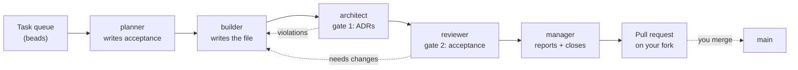
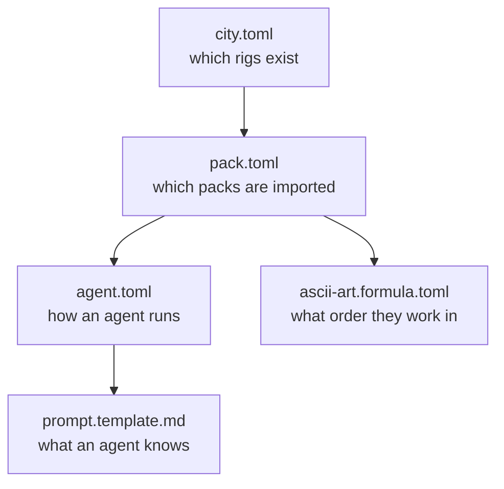

# Actual Factory Demo

Build a working software factory in about fifteen minutes, then watch five agents carry a task from a queue to an open pull request without you writing the code.

This repo is the hands-on companion to a short Claude Code workshop talk, so it's deliberately small. Everything you need is on this page. Want the full multi-day curriculum instead? That lives in [`actual-software/sf-tutorial`](https://github.com/actual-software/sf-tutorial).

## Table of contents

- [What you build](#what-you-build)
- [Walkthrough](#walkthrough)
  - [1. Prerequisites](#1-prerequisites)
  - [2. Fork this repo](#2-fork-this-repo)
  - [3. Create the factory](#3-create-the-factory)
  - [4. Install the pack](#4-install-the-pack)
  - [5. Seed the task queue](#5-seed-the-task-queue)
  - [6. Run a task](#6-run-a-task)
  - [7. Walk the configs](#7-walk-the-configs)
- [Skipping the slow parts](#skipping-the-slow-parts)
- [Troubleshooting](#troubleshooting)
- [Going deeper](#going-deeper)

## What you build

A [Gas City](https://github.com/gastownhall/gascity) factory named `factory1`, wired to this repo as its **rig**, the project the factory works on. You hand the factory a task, and five agents pass it between themselves until the result lands as a pull request you review.



The work itself is trivial on purpose: generate ASCII art for a letter, with a rhyming couplet underneath. Nobody's here for the ASCII art, obviously. What you're actually watching is the loop around it, which is to say how work gets dispatched, who reviews it, and where the quality gates sit.

Two things are worth keeping an eye on as you go.

**Both gates hand work back rather than fixing it.** That's what the dotted lines are. A reviewer that quietly patches whatever it reviews has become a second author, and you've lost the one signal telling you something was wrong in the first place.

**No agent prompt knows the order.** They only describe roles. The sequence itself lives in a single file, `factory/formulas/ascii-art.formula.toml`, and that's where step 7 spends most of its time.

## Walkthrough

Seven steps. Each one is copy-paste runnable and ends with a check, so you can tell whether a step actually worked before you build the next one on top of it.

### 1. Prerequisites

Confirm all of these before the session starts. Installing things during a fifteen-minute talk doesn't go well.

| Tool | Why | Install |
| --- | --- | --- |
| [Claude Code](https://claude.com/claude-code) | The coding agent the factory drives | See the Claude Code docs |
| [`gh`](https://cli.github.com/) | Agents open pull requests through it | `brew install gh`, then `gh auth login` |
| [`gc`](https://github.com/gastownhall/gascity) 1.3+ | Gas City itself | `brew install gastownhall/gascity/gascity` |
| [`bd`](https://github.com/gastownhall/beads) 1.0+ | The task queue the agents read | Arrives with the Homebrew install above |
| [`dolt`](https://github.com/dolthub/dolt) 2.1+ | Storage behind `bd` | `brew install dolt` |
| `tmux`, `jq`, `git` | Session backend, JSON parsing, version control | See the note below |

**Claude Code is the one paid dependency, and it's the only one.** You don't need another account, a subscription, or an API key, and there's no Slack app to create.

Gas City runs every agent inside a `tmux` session, so `tmux` is genuinely required rather than merely recommended. Whether you have to install it yourself depends on how you got Gas City. Homebrew handles it. The formula declares `tmux`, `jq`, and `beads` as dependencies, plus `flock` on macOS, so all of them arrive together and there's nothing else for you to do. A release binary or a source build gives you `gc` and nothing else, in which case you'll want `brew install tmux jq flock` on macOS, or `apt install tmux jq` on Linux, where `flock` already ships as part of util-linux.

**Check:**

```bash
gc version      # 1.3 or newer
bd --version    # 1.0 or newer
dolt version    # 2.1 or newer
gh auth status  # must report a logged-in account
tmux -V
jq --version
```

### 2. Fork this repo

**This repo is also the rig.** Your factory writes its output back into a checkout of this same repository, so there's no second project repo to create. You do need somewhere you can push, though:

```bash
mkdir -p ~/factory-demo && cd ~/factory-demo
gh repo fork actual-software/actual-factory-demo --clone --remote
```

The city and the rig live side by side. By the end of step 3 the directory looks like this:

```text
~/factory-demo/
├── factory1/              # the Gas City, created next
└── actual-factory-demo/   # your fork, which is also the rig
```

**Check:** `git -C actual-factory-demo remote -v` shows `origin` pointing at **your** fork. If it points at `actual-software`, you cloned instead of forking, and step 6's pull request will fail on push rights.

### 3. Create the factory

```bash
cd ~/factory-demo
gc init factory1
```

`gc init` is interactive and asks two questions:

- Config template: **minimal** (option `2`)
- Provider: **Claude Code**, or whichever agent you actually have installed

That writes `factory1/`, holding a `city.toml` and a `pack.toml`. Both are short enough to read end to end, and step 7 comes back to them.

The minimal template ships a stock `mayor` agent. This demo replaces it with the pack's own `manager`, so drop it before anything starts up:

```bash
cd factory1
export FACTORY_PATH="$(pwd)"

rm -rf agents/mayor
sed -i.bak '/^\[\[named_session\]\]$/,/^  mode = "always"$/d' pack.toml && rm -f pack.toml.bak
```

Now start it:

```bash
gc start
```

`gc start` registers the city with the supervisor, installs the background service if this is your first city, and brings up the city's Dolt server along with its agents.

**From here on the supervisor owns the Dolt server.** Don't run `bd dolt start` yourself. It starts a second Dolt that takes a write lock on the same data directory, and the next restart then fails because the supervisor can't bring up its own. It's far and away the most common way a first run goes wrong.

**Check:**

```bash
gc cities       # factory1, with its absolute path
gc status       # Controller: supervisor-managed (PID ...)
gc doctor       # ✓ pass, ⚠ warning, ✗ error
```

`gc doctor --fix` clears the routine warnings a fresh city reports. Run `gc doctor` again afterwards and you should be down to passes.

### 4. Install the pack

A **pack** is how Gas City ships agents, formulas, and config as one installable unit. This demo has exactly one, and it lives in this repo at `factory/`.

Register your fork as the rig, then import the pack into it:

```bash
cd "$FACTORY_PATH"
export RIG_PATH="$(cd ../actual-factory-demo && pwd)"

gc rig add "$RIG_PATH" --name ascii-art
gc import add --rig ascii-art "$RIG_PATH/factory"
gc restart
```

The rig is named `ascii-art` because that's the work it holds. The directory keeps its own name. The two don't have to match.

The `--rig ascii-art` on the import is load-bearing. It binds the five agents to the rig, which is what puts them in your fork's checkout when they run. Import without it and the agents come up at city scope, where there's no repo to write to.

**Check:**

```bash
gc import list --rig ascii-art   # factory, with a locked commit
gc formula list --rig ascii-art  # ascii-art, alongside the built-ins
gc status                        # five ascii-art/factory.* agents
```

You're looking for `ascii-art/factory.manager` as an always-on named session, with `planner`, `builder`, `architect`, and `reviewer` sitting underneath it as pool agents.

### 5. Seed the task queue

The agents read work from **beads**, which is a task queue backed by Dolt. Yours is empty right now. The seed script opens two epics and twenty-six tasks, one per letter:

```bash
cd "$RIG_PATH"
./seed.sh
```

Each task carries `metadata.target_file` naming the file it owns, something like `ascii/a.md`. That's how an agent figures out where to write without having to parse its own task title, which is exactly the kind of thing you don't want an agent guessing at.

It refuses to run twice, so don't worry about re-running it if you're not sure the first one took.

**Check:**

```bash
bd list --type=epic   # Letters a–m and Letters n–z
bd ready              # twenty-six tasks with no blockers
```

### 6. Run a task

Pick a letter, and grab its bead id:

```bash
cd "$RIG_PATH"
export BEAD_ID=$(bd list --type=task --status=open --limit 0 | grep -E "Implement a\.md$" | awk '{print $2}')
bd show "$BEAD_ID"
```

Hand it to the factory:

```bash
cd "$FACTORY_PATH"
gc sling ascii-art/factory.planner "$BEAD_ID" --on ascii-art
```

Every part of that command is doing something:

- `ascii-art/factory.planner` names the target as `<rig>/<pack>.<agent>`
- `$BEAD_ID` is the task
- `--on ascii-art` attaches the formula, which is what tells every agent downstream what runs after it

Watch the task move:

```bash
while true; do clear; bd show "$BEAD_ID"; sleep 5; done
```

Here is the sequence to look for:

1. An `assignee` appears and the status flips to `in_progress`. The planner claimed it.
2. Acceptance shows up in the notes. The planner has written down what done means.
3. `pr_url` gets stamped. The builder pushed a branch and opened the pull request.
4. `adr_verdict: clean` appears. First gate cleared.
5. `review_verdict: pass` appears. Second gate cleared, and the manager closes the task out.

Steps 4 and 5 are the ones worth pausing on. Each gate read the actual diff and made a call. Had either rejected the work, you'd see `violations` or `needs_changes` with a reason in the notes, and the task would land back with the builder rather than becoming somebody else's cleanup job.

Want to watch an agent work instead of watching its metadata?

```bash
gc session list
gc session attach <session-name>
```

**Detach with `Ctrl+b` then `d`.** Never `Ctrl+c`. That one kills the session outright, and you'll be restarting the whole city just to get it back.

Look at what came out, and merge it:

```bash
cd "$RIG_PATH"
gh pr view "$(bd show "$BEAD_ID" --json | jq -r '.[0].metadata.pr_url')" --web
gh pr merge <number> --merge
```

You should see one new file at `ascii/a.md`, holding an H1 with the letter, a fenced code block with the art in it, and a two-line rhyme. Those constraints aren't arbitrary. They come from [ADR 0001](./adrs/0001.ADR.ASCII.md), which the agents read as part of their context.

Run another if you like. Same loop, `b.md` instead of `a.md`. Two or three is plenty though, since the interesting part has already happened and you'll want clean state to poke at afterwards.

**Check:**

```bash
cd "$RIG_PATH"
git fetch origin && git pull
ls ascii/                   # the letters you ran
gh pr list --state=merged   # one merged pull request per letter
```

### 7. Walk the configs

Nothing to install here, and nothing to wait on. This is just the read-through that turns "huh, it worked" into "I could change it."



**`city.toml`, which says what the factory contains.**

```bash
cat "$FACTORY_PATH/city.toml"
```

A `[workspace]` block naming your provider, plus one `[[rigs]]` entry per project. That second block is what `gc rig add` wrote for you back in step 4.

**`agent.toml`, which says how an agent runs.**

```bash
cat "$RIG_PATH/factory/agents/builder/agent.toml"
cat "$RIG_PATH/factory/agents/reviewer/agent.toml"
```

Four lines each, and between them they decide the agent's whole operational shape. `wake_mode = "fresh"` is the one to notice. Every session starts with no memory of the last one, so anything an agent needs has to reach it through the task or the repo, which is why the planner's acceptance ends up carrying so much weight.

**`ascii-art.formula.toml`, which says what order they work in.** If you only read one file today, make it this one.

```bash
gc formula show ascii-art --rig ascii-art
```

Five steps, chained by `needs`, one per agent. Each says what that agent produces and who gets it next. Read `adr-check` in particular. See the branch where the gate finds a violation? It routes straight back to the builder, and that one line is basically the entire review loop.

**`prompt.template.md`, which says what an agent knows.**

```bash
cat "$RIG_PATH/factory/agents/reviewer/prompt.template.md"
```

Forty-odd lines. Not one of them mentions ASCII art, and not one names the agent that runs next, because a prompt here only describes a role: what this agent judges, what habits it brings to the job, and when it's allowed to stop.

That split is the demo's most transferable idea, and it's the bit worth stealing. Sequence lives in the formula. Role lives in the prompt. Reorder the pipeline and you're editing one file instead of five, and pointing these same five agents at your own codebase just means writing a new formula and leaving every prompt where it is.

**Try changing something.** Open `factory/agents/builder/agent.toml`, bump `max_active_sessions`, then run `gc reload` and `gc status`. You'll see the cap move with it.

## Skipping the slow parts

Step 6 takes a few minutes of real agent time. That's fine when you're working through this alone. It's awkward when a room is watching.

The [`ascii-art-complete`](https://github.com/actual-software/actual-factory-demo/tree/ascii-art-complete) branch holds finished output from an earlier run, already committed:

```bash
git checkout ascii-art-complete
ls ascii/
```

Use it to skip ahead, to check your own output against a known-good result, or just to see where you're heading before you start.

## Troubleshooting

**`gc status` says `Controller: stopped`, and `bd` reports "Dolt server unreachable".** You ran `gc init` but never `gc start`, so all the files exist on disk while nothing is actually running behind them. Run `gc start` from inside `factory1/`. And don't reach for `bd dolt start` here, however much it looks like the obvious fix, because that just swaps this problem for the next one.

**`gc start` fails with `dolt server could not start via gc helper`.** Another Dolt process holds the lock. Usually a leftover `bd dolt start`. Worse, `bd dolt stop` won't reliably terminate it. Find it with `ps aux | grep "dolt sql-server" | grep -v grep`, leave alone any process started with `--config .../.gc/runtime/...` because that one belongs to the supervisor, kill the others, then re-run `gc start`.

**`gc formula list --rig ascii-art` doesn't show `ascii-art`.** The pack went in at the wrong scope. Check `gc import list --rig ascii-art`, and if it comes back empty the import landed at city scope instead. Run `gc import remove factory`, then re-add it with the `--rig ascii-art` flag.

**`gc status` shows a `mayor` alongside the pack's agents.** The stock mayor is still declared. Re-run the two removal commands from step 3, then `gc restart`.

**`./seed.sh` reports "No issues found" afterwards.** You ran it somewhere other than the rig directory, so the beads landed in a different database entirely. Check `pwd`, `cd "$RIG_PATH"`, re-run.

**The planner never claims the task.** Confirm the agent is actually running with `gc session list`, then `bd show "$BEAD_ID"`. Still blank `assignee` after a few seconds? The sling didn't dispatch. Re-run it and read the output for an error.

**The pull request opened on the wrong repository.** Run `git remote -v` in the rig. `origin` has to point at your fork. If you cloned this repo directly instead of forking it you have no push rights, and the builder's `gh pr create` is where that finally surfaces.

**The scroll wheel walks your shell history inside `tmux`.** That's a terminal setting rather than a Gas City problem. Most terminals have a "scroll to alternate screen" or "alternate scroll mode" option that fixes it.

## Going deeper

This demo stops as soon as one task has made it through the loop. [`sf-tutorial`](https://github.com/actual-software/sf-tutorial) picks up from the same place and keeps layering: branch protection so only humans merge to `main`, a reviewer that reads your ADRs in depth, and a review gate on the tasks themselves. Its `progression/02-first-review-loop.md` is the direct next step after step 6 here.

Questions, or want to show off what you built? Join the [Actual AI User Community Slack](https://join.slack.com/t/actualaiusercommunity/shared_invite/zt-3vibgzapf-ywx0Db29mZ4lhtQJGzZfGQ).
